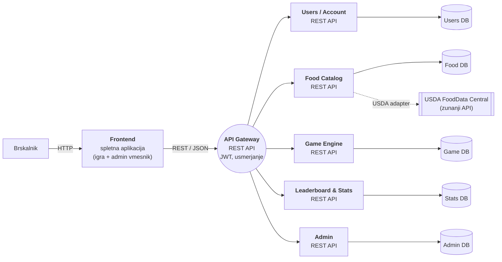

# CalorieSort 🍎🥤

**Projekt pri predmetu Storitveno usmerjene arhitekture — idejna zasnova mikrostoritev**

CalorieSort je spletna igra, v kateri igralec z vlečenjem (*drag & drop*) razvrsti **jedi ali pijače** od tiste z **najmanjšo** do tiste z **največjo** vrednostjo izbranega kriterija (npr. kalorij). Po oddaji igra pokaže pravilen vrstni red, prave vrednosti in dosežene točke. Podatke o živilih uvozimo iz javnega API-ja **USDA FoodData Central**.

Aplikacija je zgrajena kot sistem **5 mikrostoritev**, ki jih dopolnjujeta **Frontend** (spletna aplikacija) in **API Gateway**. Vse storitve komunicirajo prek **REST (JSON prek HTTP)**.

---

## 1. Skupina in razdelitev dela

| | |
|---|---|
| **Ime skupine** | `[ime_skupine]` |
| **Število članov** | 3 |

| Član | Storitve, ki jih razvija | Št. mikrostoritev |
|---|---|---|
| `[Član 1]` | **Food Catalog Service** + **Game Engine Service** | 2 |
| `[Član 2]` | **Users / Account Service** + **Leaderboard & Stats Service** (+ API Gateway) | 2 |
| `[Član 3]` | **Frontend** (spletna aplikacija) + **Admin Service** | 1 + Frontend |

---

## 2. Opis igre

### 2.1 Osnovni potek runde

1. Igra prikaže npr. **4 živila** (jedi ali pijače) in **kriterij**, npr. *"Razvrsti po beljakovinah"*.
2. Igralec jih z vlečenjem razvrsti od najmanjše do največje vrednosti.
3. Po oddaji igra prikaže **pravilen vrstni red**, **prave vrednosti** in **točke** za rundo.

Prave vrednosti so do oddaje znane samo strežniku (Game Engine), zato jih igralec ne more prebrati iz odgovora brskalnika.

### 2.2 Enota in kriteriji

Vse vrednosti so izražene **na 100 g** živila.

| Kriterij | Enota | USDA nutrient ID |
|---|---|---|
| Kalorije (energija) | kcal / 100 g | 1008 |
| Vlaknine | g / 100 g | 1079 |
| Voda | g / 100 g | 1051 |
| Beljakovine | g / 100 g | 1003 |
| Sladkor | g / 100 g | 2000 |

### 2.3 Načini igre

| Način | Opis |
|---|---|
| **Klasični** | Igralec ima **3 življenja**. Ob napačno razvrščeni rundi izgubi eno življenje. Igra se konča, ko ostane brez življenj. |
| **Dnevni izziv** | **Isti izziv za vse igralce** (ista živila in kriteriji), igra se ga lahko **enkrat na dan**. Ima svojo dnevno lestvico. |
| **Na čas** | Igralec ima **60 sekund**, da razvrsti čim več rund. Čas meri strežnik, ne brskalnik. |

### 2.4 Težavnost

Težavnost je **večja, ko je razlika med vrednostmi živil v rundi manjša**. Za vsako rundo izračunamo najmanjšo relativno razliko med sosednjima vrednostma (po razvrstitvi):

| Stopnja | Najmanjša relativna razlika med sosednjima živiloma (predlog) |
|---|---|
| Lahka | ≥ 40 % |
| Srednja | 15–40 % |
| Težka | < 15 % |

V rundi ne sme biti dveh živil z enako vrednostjo, sicer pravilni vrstni red ne bi bil enoličen. V klasičnem načinu se težavnost postopno stopnjuje (npr. vsake 3 runde ena stopnja višje).

### 2.5 Točkovanje (predlog)

- V celoti pravilno razvrščena runda: **10 točk**.
- Delno pravilna runda: **2 točki** za vsako živilo na pravilnem mestu.
- Množitelj glede na težavnost: lahka ×1, srednja ×1,5, težka ×2 (npr. pravilna težka runda = 20 točk).
- Klasični način: runda, ki ni v celoti pravilna, stane eno življenje.
- Način na čas: napačna runda ne odvzame življenja, le prinese manj točk.

---

## 3. Shema arhitekture

**Legenda**

- Krog = vstopna točka (API Gateway), pravokotnik = storitev, valj = baza podatkov.
- Polne puščice = sinhroni REST klici (JSON prek HTTP).
- Črtkana puščica = klic zunanjega API-ja prek adapterja v Food Catalog storitvi.
- Zaradi preglednosti klici med storitvami (npr. Game Engine → Food Catalog) niso narisani v shemi, ampak so navedeni v tabeli 3.1.

### 3.1 Kdo koga kliče

| Klicatelj | Kliče | Zakaj |
|---|---|---|
| Frontend | API Gateway | vse zahteve uporabnika |
| API Gateway | vse storitve | posreduje zahteve glede na pot (`/api/users/...` → Users …) |
| Game Engine | Food Catalog | dobi živila za rundo |
| Game Engine | Leaderboard & Stats | ob koncu igre pošlje rezultat |
| Admin | Users, Food Catalog, Leaderboard & Stats, Game Engine | administratorska opravila |
| Food Catalog | USDA FoodData Central | uvoz podatkov o živilih |

---

## 4. Opis storitev in klicev (API)

Poti v tabelah so poti **znotraj posamezne storitve**. Frontend jih kliče prek API Gatewaya s predpono `/api`, npr. `GET /api/foods/123` → Food Catalog `GET /foods/123`.

Oznake v stolpcu *Dostop*: **javno** (brez prijave), **igralec** (prijavljen uporabnik), **admin** (vloga administratorja), **interno** (samo klici med storitvami, ne prek Gatewaya).

### 4.1 API Gateway

**Razvija:** `[Član 2]`

**Naloga:** edina vstopna točka za Frontend.

- Usmerja zahteve na prave storitve glede na pot.
- Preveri JWT žeton (podpis in veljavnost) in storitvam posreduje glavi `X-User-Id` in `X-User-Role`.
- Zavrne zahteve brez ustrezne vloge (npr. `/api/admin/**` samo za admina).
- Skrbi za CORS in osnovno omejevanje števila zahtev (*rate limiting*).

| Pot na Gatewayu | Posreduje na |
|---|---|
| `/api/auth/**`, `/api/users/**` | Users / Account |
| `/api/foods/**`, `/api/criteria` | Food Catalog |
| `/api/games/**` | Game Engine |
| `/api/leaderboard/**`, `/api/stats/**` | Leaderboard & Stats |
| `/api/admin/**` | Admin |

---

### 4.2 Users / Account Service

**Razvija:** `[Član 2]` · **Baza:** Users DB

**Kaj počne:** registracija in prijava uporabnikov, izdaja JWT žetonov, upravljanje profila in vlog (igralec / admin).

**Podatki:** `users (id, username, email, password_hash, role, created_at, is_banned)`

| Metoda | Pot | Opis | Dostop |
|---|---|---|---|
| POST | `/auth/register` | Registracija novega uporabnika | javno |
| POST | `/auth/login` | Prijava, vrne JWT žeton | javno |
| POST | `/auth/refresh` | Osveži potekel žeton | igralec |
| GET | `/users/me` | Podatki prijavljenega uporabnika | igralec |
| PUT | `/users/me` | Posodobitev profila (uporabniško ime, geslo) | igralec |
| DELETE | `/users/me` | Izbris računa | igralec |
| GET | `/users/{id}` | Javni profil (uporabniško ime) — npr. za prikaz na lestvici | javno |
| GET | `/users` | Seznam uporabnikov (iskanje, strani) | admin / interno |
| PATCH | `/users/{id}` | Sprememba vloge ali blokada uporabnika | admin / interno |

---

### 4.3 Food Catalog Service

**Razvija:** `[Član 1]` · **Baza:** Food DB · **Zunanji vir:** USDA FoodData Central (prek adapterja)

**Kaj počne:** hrani katalog jedi in pijač z vrednostmi petih kriterijev na 100 g, uvaža podatke iz USDA API-ja in Game Engineu vrača skupine živil, ki ustrezajo želeni težavnosti.

**Podatki:** `foods (id, fdc_id, name, name_sl, category, calories, fiber, water, protein, sugar, image_url, is_active)`

| Metoda | Pot | Opis | Dostop |
|---|---|---|---|
| GET | `/criteria` | Seznam kriterijev z enotami | javno |
| GET | `/foods` | Seznam živil (iskanje `?q=`, `?category=`, strani) | javno |
| GET | `/foods/{id}` | Podrobnosti enega živila z vsemi vrednostmi | javno |
| GET | `/categories` | Seznam kategorij (sadje, pijače, sladice …) | javno |
| GET | `/foods/sample?count=N&criterion=protein&difficulty=hard` | Vrne `count` (število živil v rundi) naključnih živil z različnimi vrednostmi, ki ustrezajo težavnosti | interno (Game Engine) |
| POST | `/foods/import` | Uvoz živil iz USDA (`{ query, dataType, limit }` ali seznam `fdcId`) | admin / interno |
| PUT | `/foods/{id}` | Ročni popravek (npr. slovensko ime, slika) | admin / interno |
| PATCH | `/foods/{id}` | Skrij / prikaži živilo (`is_active`) | admin / interno |
| DELETE | `/foods/{id}` | Izbris živila | admin / interno |

---

### 4.4 Game Engine Service

**Razvija:** `[Član 1]` · **Baza:** Game DB

**Kaj počne:** vsebuje pravila igre. Ustvari igro in runde, hrani prave vrednosti, preveri oddani vrstni red, izračuna točke, vodi življenja (klasični način), meri čas (način na čas) in pripravi dnevni izziv.

**Podatki:**

- `games (id, user_id, mode, criterion, score, lives, started_at, ends_at, status)`
- `rounds (id, game_id, number, criterion, difficulty, food_ids, correct_order, submitted_order, points)`
- `daily_challenges (date, rounds_definition)`

| Metoda | Pot | Opis | Dostop |
|---|---|---|---|
| POST | `/games` | Začne novo igro `{ mode: "classic" \| "daily" \| "timed", criterion? }`, vrne `gameId` in prvo rundo | igralec |
| GET | `/games/{gameId}` | Trenutno stanje igre (točke, življenja, preostali čas) | igralec |
| GET | `/games/{gameId}/rounds/current` | Trenutna runda: živila in kriterij, **brez vrednosti** | igralec |
| POST | `/games/{gameId}/rounds/{n}/answer` | Oddaja vrstnega reda `{ order: [foodId, …] }`, vrne pravilen vrstni red, vrednosti, točke in stanje | igralec |
| POST | `/games/{gameId}/finish` | Predčasni konec igre; rezultat se pošlje Leaderboardu | igralec |
| GET | `/games/daily` | Podatki o današnjem izzivu in ali ga je igralec že odigral | igralec |
| PUT | `/games/daily/{date}` | Ročna nastavitev dnevnega izziva za izbrani dan | admin / interno |

**Kliče:** Food Catalog (`GET /foods/sample`), Leaderboard & Stats (`POST /results`).

---

### 4.5 Leaderboard & Stats Service

**Razvija:** `[Član 2]` · **Baza:** Stats DB

**Kaj počne:** shranjuje končne rezultate iger, vodi lestvice (po načinu igre in obdobju) in računa statistiko igralcev ter živil (npr. katera živila igralci najpogosteje napačno razvrstijo).

**Podatki:**

- `results (id, game_id, user_id, username, mode, score, rounds_played, rounds_correct, played_at)`
- `food_mistakes (food_id, criterion, times_shown, times_misplaced)`

| Metoda | Pot | Opis | Dostop |
|---|---|---|---|
| POST | `/results` | Shrani rezultat končane igre (s podatki o rundah) | interno (Game Engine) |
| GET | `/leaderboard?mode=classic&period=week&limit=10` | Lestvica za način igre in obdobje (`day`, `week`, `all`) | javno |
| GET | `/leaderboard/daily/{date}` | Lestvica dnevnega izziva za izbrani dan | javno |
| GET | `/stats/users/{userId}` | Statistika igralca: št. iger, najboljši in povprečni rezultat, natančnost po kriterijih | igralec |
| GET | `/stats/users/{userId}/history` | Zgodovina iger igralca | igralec |
| GET | `/stats/foods/hardest?criterion=sugar` | Živila, ki jih igralci najpogosteje napačno razvrstijo | javno |
| GET | `/stats/global` | Splošna statistika (št. iger, najbolj priljubljen način …) | admin / interno |
| DELETE | `/results/{id}` | Odstrani rezultat (npr. goljufanje) | admin / interno |

---

### 4.6 Admin Service

**Razvija:** `[Član 3]` · **Baza:** Admin DB

**Kaj počne:** zaledje za administratorski vmesnik. Administratorska opravila izvaja tako, da kliče API-je drugih storitev, in vsako akcijo zapiše v revizijski dnevnik (*audit log*). Ne bere baz drugih storitev.

**Podatki:** `audit_log (id, admin_id, action, target_service, target_id, payload, created_at)`

| Metoda | Pot | Opis | Dostop | Kliče |
|---|---|---|---|---|
| GET | `/admin/dashboard` | Povzetek: št. uporabnikov, iger, živil | admin | Users, Stats, Food Catalog |
| POST | `/admin/foods/import` | Sproži uvoz živil iz USDA | admin | Food Catalog |
| PATCH | `/admin/foods/{id}` | Uredi ali skrij živilo | admin | Food Catalog |
| GET | `/admin/users` | Seznam uporabnikov | admin | Users |
| PATCH | `/admin/users/{id}` | Blokada uporabnika / sprememba vloge | admin | Users |
| DELETE | `/admin/results/{id}` | Odstrani sporen rezultat | admin | Leaderboard & Stats |
| PUT | `/admin/daily-challenge/{date}` | Nastavi dnevni izziv za izbrani dan | admin | Game Engine |
| GET | `/admin/audit-log` | Pregled vseh administratorskih akcij | admin | — |

---

### 4.7 Frontend (spletna aplikacija)

**Razvija:** `[Član 3]`

**Kaj počne:** uporabniški vmesnik v brskalniku. Kliče **samo API Gateway**.

Zasloni:

- prijava / registracija,
- izbira načina igre in kriterija,
- igralna plošča s karticami živil in *drag & drop* razvrščanjem,
- prikaz rezultata runde (pravilen vrstni red, vrednosti, točke, življenja / preostali čas),
- lestvice (klasični, na čas, dnevni izziv),
- profil s statistiko igralca,
- administratorski vmesnik (uvoz in urejanje živil, uporabniki, rezultati, dnevni izziv).

---

## 5. Vir podatkov: USDA FoodData Central

- API: `https://api.nal.usda.gov/fdc/v1/` (potreben brezplačen API ključ z api.data.gov).
- Uporabljeni klici: `GET /foods/search` (iskanje živil), `GET /food/{fdcId}` in `POST /foods` (podrobnosti enega ali več živil).
- Uporabljamo predvsem podatkovna tipa **SR Legacy** in **Foundation**, ker sta vrednosti hranil podana na 100 g.
- Uvoz izvaja **samo Food Catalog Service** (adapter). Igra med igranjem ne kliče USDA API-ja, temveč dela z lastno bazo, zato je hitra in deluje tudi, če zunanji API ni dosegljiv.
- Pri uvozu izločimo živila, ki nimajo vseh petih vrednosti.
